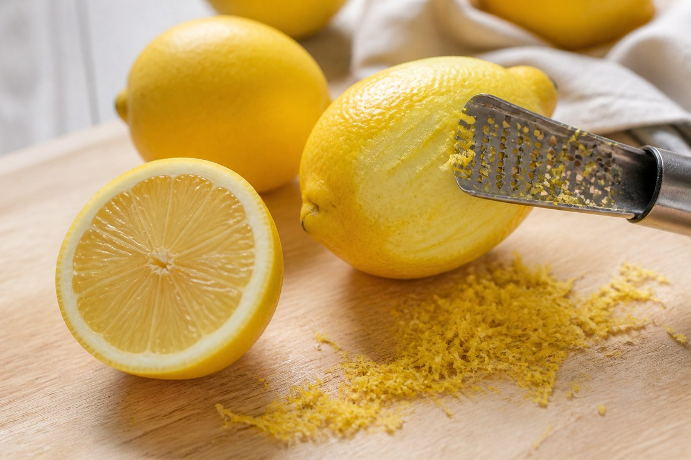

*▲ 레몬 과육 100g은 36kcal, 비타민C 52.07mg입니다. 껍질 100g은 비타민C 129mg, 식이섬유 10.6g으로 과육과 값이 다릅니다.*

한 줄 결론 <strong>레몬 과육(껍질 제외) 100g은 36kcal, 비타민C 52.07mg, 식이섬유 1.1g입니다(농촌진흥청 국가표준식품성분표, 2014).</strong> 같은 레몬의 <strong>껍질 100g은 비타민C 129mg, 식이섬유 10.6g</strong>(USDA FDC 167749)입니다. 즙만 짜면 레몬 한 개에서 비타민C <strong>12~15mg</strong> 남짓을 얻고 나머지는 버리는 셈입니다. 껍질을 다 먹는 사람은 드물지만, <strong>제스트·레몬청·냉동 갈이로 껍질을 조금이라도 쓰는 쪽이 실속</strong>입니다. 단 산 성분이 치아와 위를 자극하므로 양과 방법은 따져야 합니다.

레몬은 요리에서 '즙 한 스푼'으로만 쓰는 재료로 굳어 있습니다. 생선 비린내를 잡고, 샐러드에 산미를 얹고, 물에 한 조각 띄우는 용도. 그러다 보니 껍질은 늘 쓰레기통으로 갑니다. 저도 오래 그렇게 썼습니다.

바뀐 건 레몬청을 직접 담그면서부터였습니다. 껍질을 얇게 저며 설탕에 재웠는데, 며칠 뒤 병을 열었을 때 향이 즙만 짰을 때와 완전히 달랐습니다. 막상 이렇게 해보니 <strong>레몬에서 가장 값싸게 버려지는 부분이 사실은 향과 비타민C가 가장 진한 부분</strong>이라는 게 이상하게 느껴졌습니다. 그래서 공식 성분표를 나란히 놓고 숫자로 확인해 봤습니다.

많이 검색되는 질문은 <strong>"레몬 한 개 비타민C"</strong>, <strong>"레몬 껍질 먹어도 되나"</strong>, <strong>"레몬수 하루 한 잔 효과"</strong>, <strong>"레몬청 껍질 왁스"</strong>입니다. 이 글은 그 네 가지를 순서대로 다룹니다.

---

## 1. 레몬 영양성분 (과육 100g, 36kcal)

아래 표는 <strong>농촌진흥청 국가표준식품성분표(DB 10.4)의 '레몬, 생것' 가식부 100g</strong> 값입니다. 여기서 '가식부'가 중요합니다. 레몬은 <strong>폐기율 37%</strong>로 잡혀 있어서, 이 표의 값은 <strong>껍질과 씨를 뺀 과육만</strong> 분석한 수치입니다.

| 영양 성분 (Nutrient) | 함량 (100g당) | 1일 기준치 비율 (2,000kcal 기준) |
| :--- | :--- | :--- |
| **열량 (Energy)** | 36 kcal | 1.8% |
| **수분 (Water)** | 89.6 g | 기준치 없음¹ |
| **탄수화물 (Carbohydrates)** | 9.27 g | 2.9% |
| - 당류 (Sugars) | 2.25 g | 2.3% |
| - 식이섬유 (Dietary Fiber) | 1.1 g | 4.4% |
| **단백질 (Protein)** | 0.71 g | 1.3% |
| **지방 (Total Fat)** | 0.08 g | 0.1% |
| **칼슘 (Calcium)** | 32 mg | 4.6% |
| **인 (Phosphorus)** | 22 mg | 3.1% |
| **철분 (Iron)** | 0.1 mg | 0.8% |
| **칼륨 (Potassium)** | 122 mg | 3.5% |
| **나트륨 (Sodium)** | 2 mg | 0.1% |
| **비타민C (Vitamin C)** | 52.07 mg | 52% |
| **티아민 (Thiamin)** | 0.06 mg | 5% |
| **리보플라빈 (Riboflavin)** | 0.06 mg | 4.3% |
| **나이아신 (Niacin)** | 0.54 mg | 3.6% |
| **엽산 (Folate)** | 40 µg DFE | 10% |

¹ 수분은 1일 기준치가 설정되지 않은 항목입니다. 비율은 식품의약품안전처 1일 영양성분 기준치(2,000kcal)로 계산했습니다.

*※ 데이터 기준: 농촌진흥청 국가표준식품성분표 '레몬, 생것' 2014년 분석값(가식부 100g, 폐기율 37%). [USDA FoodData Central FDC 167746](https://fdc.nal.usda.gov/food-details/167746/nutrients) — Lemons, raw, without peel는 100g당 29 kcal·단백질 1.1 g·식이섬유 2.8 g·칼륨 138 mg·비타민C 53 mg으로, 국내 표와 열량·섬유에서 차이가 있습니다.*

### 표 읽는 법: 레몬 한 개는 100g이 아니다

- <strong>레몬 한 개를 사면 무게는 120~150g이지만, 껍질과 씨를 빼면 먹는 부분은 80~95g</strong>입니다. 폐기율 37%를 그대로 적용하면 구입 100g에서 63g만 남습니다.
- <strong>비타민C 52mg은 성인 1일 권장량(100mg)의 절반</strong>입니다. 다만 이건 <strong>과육을 통째로 먹었을 때</strong> 이야기입니다. 실제로는 즙만 짜서 씁니다.
- <strong>국내 표는 36kcal, USDA는 29kcal</strong>입니다. 껍질을 포함했는지, 품종이 무엇인지에 따라 갈리는 값이라 방향만 보면 됩니다. 어느 쪽이든 레몬은 <strong>100g에 40kcal가 안 되는 저열량 재료</strong>입니다.
- <strong>레몬의 신맛은 구연산</strong>입니다. 당류가 2.25g인데도 새콤하게만 느껴지는 이유이고, 그래서 레몬청처럼 설탕을 넣는 가공에서 열량이 확 올라갑니다.

---

## 2. 즙만 짜면 무엇을 버리는가

레몬을 반으로 갈라 즙을 짜면, 손에 쥔 껍질은 대부분 버려집니다. 그 껍질이 어떤 값인지 보겠습니다.

| 항목 (100g당) | 과육 (껍질 제외) | 껍질 | 배수 |
| :--- | :--- | :--- | :--- |
| **열량** | 29 kcal | 47 kcal | 1.6배 |
| **비타민C** | 53 mg | **129 mg** | **2.4배** |
| **식이섬유** | 2.8 g | **10.6 g** | **3.8배** |
| **칼슘** | 26 mg | 130 mg | 5배 |
| **칼륨** | 138 mg | 160 mg | 1.2배 |
| **당류** | 2.5 g | 4.17 g | 1.7배 |

*※ 과육 값은 USDA FDC 167746(Lemons, raw, without peel), 껍질 값은 USDA FDC 167749(Lemon peel, raw) 100g 기준입니다. 국내 성분표에는 레몬 껍질 항목이 따로 없어 USDA 값으로 비교했습니다.*

숫자만 보면 껍질이 압도적입니다. 하지만 여기서 한 번 더 계산해야 합니다. <strong>껍질을 100g 먹을 일은 없기 때문</strong>입니다.

- 레몬 한 개의 껍질 무게는 <strong>30~40g</strong> 남짓입니다.
- 제스트(강판에 간 껍질) 한 큰술은 <strong>약 6g</strong>입니다. 이 정도면 비타민C <strong>7.7mg</strong>, 식이섬유 <strong>0.6g</strong>입니다.
- 그래도 <strong>즙 30ml(비타민C 12~15mg)에 껍질 제스트를 더하면 한 개에서 얻는 비타민C가 두 배 가까이</strong> 됩니다.

개인적으로는 이 계산이 <strong>"껍질이 몸에 좋다"는 말보다 훨씬 쓸모 있었다</strong>는 생각입니다. 껍질을 건강식으로 먹자는 게 아니라, <strong>어차피 사서 쓰는 레몬에서 버리는 부분을 조금만 더 쓰자</strong>는 정도의 이야기입니다.

### 껍질에만 있는 것: 리모넨

레몬 향의 정체는 <strong>리모넨</strong>입니다. 농식품정보누리에 따르면 레몬 겉껍질에는 <strong>아로마 오일이 6%</strong> 들어 있고, 그 오일의 <strong>90%가 리모넨</strong>입니다. 과육 즙에는 이 성분이 거의 없습니다.

향 성분이라 영양소처럼 수치로 기대할 것은 아니지만, <strong>레몬즙만 짜면 레몬의 절반(향)을 그냥 흘려보내는 셈</strong>이라는 점은 분명합니다. 생선 비린내를 잡는 것도 실은 이 향 성분과 산의 조합입니다.

---

## 3. 껍질을 쓰는 실전: 씻기·제스트·보관

껍질을 쓰기로 마음먹으면 첫 관문은 <strong>왁스와 농약 걱정</strong>입니다. 수입 레몬은 선도를 유지하려고 표면에 왁스를 입히는 경우가 많습니다.

- <strong>베이킹소다물에 5분:</strong> 물 1L에 베이킹소다 1큰술을 풀고 레몬을 담가 둔 뒤, 굵은 소금이나 솔로 표면을 문지릅니다. 왁스가 미끈하게 풀립니다.
- <strong>뜨거운 물에 10초:</strong> 끓는 물에 잠깐 담갔다 건지면 표면 왁스가 녹아 흐릅니다. 껍질 향이 살짝 날아가는 건 감수할 부분입니다.
- <strong>유기농 표시를 확인:</strong> 제스트를 자주 쓸 거라면 유기농 레몬이 마음 편합니다. 다만 유기농도 흙과 먼지는 씻어야 합니다.

제스트를 낼 때 주의할 점은 <strong>흰 부분(알베도)을 갈지 않는 것</strong>입니다. 노란 부분까지만 갈고, 흰층이 들어가면 쓴맛이 확 올라옵니다. 강판을 레몬에 대고 살짝 눌러 돌리면 노란 층에서 저절로 멈춥니다. <strong>막상 이렇게 해보니 강판보다 필러(껍질 벗기는 도구)로 얇게 벗긴 뒤 다지는 쪽이 쓴맛이 적고 손도 덜 아팠습니다.</strong>

남은 제스트는 <strong>작은 봉투에 눌러 담아 냉동</strong>하면 됩니다. 얼린 채로 숟가락으로 긁어 쓰면 3개월은 향이 남습니다. 저는 레몬 한 봉지(5개)를 살 때마다 이렇게 제스트를 다 갈아 두고, 요거트·파스타·생선구이에 조금씩 씁니다.

---

## 4. 레몬수 한 잔에 비타민C는 얼마나

레몬수는 <strong>레몬즙을 물에 희석한 음료</strong>입니다. 여기서 기대치를 정확히 잡는 게 중요합니다.

| 만드는 법 | 레몬즙 양 | 비타민C (계산) | 비고 |
| :--- | :--- | :--- | :--- |
| 물 250ml + 즙 몇 방울 | 5 ml | 약 2 mg | 향만 내는 수준 |
| 물 250ml + 즙 1큰술 | 15 ml | 약 6 mg | 가장 흔한 레시피 |
| 물 250ml + 레몬 반 개 | 20~25 ml | 약 8~10 mg | 산미가 강함 |
| 물 250ml + 레몬 한 개 | 30~40 ml | 12~15 mg | 위가 예민하면 부담 |

*※ 레몬즙 100g의 비타민C를 38.7mg(USDA lemon juice, raw)으로 보고 환산했습니다. 즙 1ml를 1g으로 계산한 어림값입니다.*

<strong>레몬수 한 잔으로 하루 비타민C를 채운다는 기대는 무리</strong>입니다. 250ml 한 잔에 레몬 반 개를 짜도 10mg 안팎, 권장량의 10% 수준입니다. 대신 <strong>물을 마시는 습관을 만드는 데는 확실히 효과가 있습니다.</strong> 개인적으로는 아침에 레몬수 한 잔을 마시는 날이 그냥 물만 마시는 날보다 하루 물 섭취량이 훨씬 많았습니다.

주의할 점도 분명합니다.

- <strong>뜨거운 물에 즙을 짜면 비타민C가 더 빠르게 줄어듭니다.</strong> 미지근한 물이나 상온수가 낫습니다.
- <strong>레몬청은 레몬즙 음료가 아니라 설탕 음료</strong>입니다. 레몬과 설탕을 1:1로 재우기 때문에 한 큰술에 당이 8~10g 들어갑니다. 레몬청을 넣은 레몬수는 <strong>하루 비타민C보다 당 섭취가 먼저 걱정</strong>되는 음료입니다.
- <strong>올레샷(올리브오일+레몬즙)처럼 기름과 함께 먹는 방식</strong>은 최근 유행이지만, 열량은 올리브오일 쪽에서 옵니다. 올리브오일 1티스푼이 40kcal 안팎이니 하루 한 번 정도가 무난합니다.

---

## 5. 섭취 시 주의사항

- <strong>치아가 먼저 상합니다.</strong> 구연산은 법랑질을 무르게 합니다. 레몬수를 하루 종일 홀짝이거나 양치 직후 마시면 손상이 커집니다. <strong>빨대로 마시고, 마신 뒤 물로 입을 헹구고, 양치는 30분 뒤</strong>가 안전합니다.
- <strong>역류성 식도염·위염이 있으면 공복은 피하세요.</strong> 산도가 높아 속쓰림이 심해질 수 있습니다. 식후나 식사 중간이 낫습니다.
- <strong>껍질을 만진 뒤 햇빛을 오래 쬐지 마세요.</strong> 레몬 껍질 기름에는 광독성 성분(5-메톡시소랄렌 계열)이 있어, 손에 묻힌 채 강한 햇빛을 오래 보면 피부가 붉어지고 얼룩이 남을 수 있습니다. 흐르는 물에 씻으면 됩니다.
- <strong>자몽처럼 약물 상호작용이 크지는 않습니다.</strong> 자몽은 CYP3A4를 억제해 일부 약의 혈중 농도를 올리지만, 레몬에 같은 임상 근거는 약합니다. 그래도 <strong>복용 중인 약이 있다면 과량의 레몬즙을 습관처럼 마시기 전에 약사와 한 번 상의</strong>하는 편이 안전합니다.
- <strong>과량 섭취는 위장 장애로 이어집니다.</strong> 하루 레몬 1~2개 분량이면 충분합니다.

---

## 6. 자주 묻는 질문 (FAQ)

**Q1. 레몬 껍질을 그냥 먹어도 되나요?**  
먹을 수는 있지만 양이 문제입니다. 껍질은 쓴맛과 단단한 질감 때문에 100g을 먹기 어렵고, 실제로는 제스트·레몬청·절임 형태로 조금씩 쓰게 됩니다. 수입 레몬은 왁스를 씻어낸 뒤 사용하고, 제스트를 낼 때는 흰 부분을 피하세요.

**Q2. 레몬수로 하루 비타민C를 채울 수 있나요?**  
어렵습니다. 레몬 한 개의 즙은 30~40ml이고 비타민C는 12~15mg으로 성인 권장량의 12~15%입니다. 레몬수는 수분 섭취와 식사 대체 음료로 의미가 있고, 비타민C는 다른 과일·채소로 채우는 편이 현실적입니다.

**Q3. 레몬청은 레몬즙보다 건강한가요?**  
영양 관점에서는 아닙니다. 레몬청은 레몬과 같은 무게의 설탕으로 재우기 때문에 한 큰술에 당류가 8~10g 들어갑니다. 껍질의 향과 식이섬유를 함께 먹을 수 있다는 장점은 있지만, 당 섭취를 함께 계산해야 합니다.

---

## 7. 레몬과 함께 쓰면 좋은 조합

- <strong>[유자 (Yuzu)](/posts/yuzu-nutrition-benefits/):</strong> 같은 감귤류지만 껍질 향이 훨씬 강합니다. 겨울철 유자청을 담글 때 레몬 제스트를 조금 섞으면 향이 더 밝아집니다.
- <strong>[모과 (Chinese Quince)](/posts/quince-nutrition-benefits/):</strong> 모과는 생으로 먹기 어려워 청으로 쓰는 과일입니다. 레몬과 함께 재우면 산미가 모과의 떫은맛을 눌러 줍니다.
- <strong>[고등어 (Mackerel)](/posts/mackerel-nutrition-benefits/):</strong> 비린내를 잡는 데는 즙보다 <strong>껍질 제스트 + 소금</strong> 조합이 낫습니다. 구운 고등어에 레몬 제스트를 뿌리면 소금을 줄여도 간이 삽니다.
- <strong>[시금치 (Spinach)](/posts/spinach-nutrition-benefits/):</strong> 시금치의 비헴철은 비타민C와 함께 먹을 때 흡수가 늘어납니다. 데친 시금치에 레몬즙을 살짝 두르는 이유가 여기 있습니다.

  
📌 관련 순위 가이드

  <ul>
    <li><a href="/posts/antioxidant-anti-aging-foods-guide/">항산화·노화 방지에 좋은 음식</a></li>
    <li><a href="/posts/low-gi-foods-blood-sugar-guide/">혈당을 천천히 올리는 저GI 음식</a></li>
  </ul>

---

## 8. 한 줄 정리

- 레몬 과육 100g은 <strong>36kcal, 비타민C 52.07mg, 식이섬유 1.1g</strong>입니다. 국내 성분표에서 레몬은 <strong>껍질을 뺀 과육(폐기율 37%)</strong>만 분석한 값입니다.
- 같은 레몬의 <strong>껍질 100g은 비타민C 129mg, 식이섬유 10.6g, 칼슘 130mg</strong>입니다(USDA 167749).
- 다만 <strong>껍질을 100g 먹을 일은 없습니다.</strong> 제스트 한 큰술(6g)이면 비타민C 7.7mg·식이섬유 0.6g입니다. 그래도 즙만 짜는 것보다는 낫습니다.
- <strong>레몬수 한 잔의 비타민C는 6~10mg</strong>입니다. 하루 권장량을 채우는 음료가 아니라, 물 마시는 습관을 돕는 음료입니다.
- <strong>레몬청은 설탕 음료</strong>입니다. 한 큰술에 당류 8~10g을 함께 계산하세요.
- 산 성분이 <strong>치아와 위를 자극</strong>합니다. 빨대·물로 헹구기·양치는 30분 뒤, 역류가 있으면 공복은 피하세요.

**추가 근거:** 과육 수치는 농촌진흥청 국가표준식품성분표(DB 10.4, '레몬, 생것', 2014)이고, 껍질 수치는 USDA FoodData Central SR Legacy FDC 167749(Lemon peel, raw), 과육 비교값은 FDC 167746(Lemons, raw, without peel)입니다. 리모넨 함량은 농림축산식품부 농식품정보누리 '제철농식품-레몬' 자료를 참고했습니다. 레몬즙 비타민C 환산값은 USDA의 lemon juice, raw 100g 기준 38.7mg을 사용했습니다.
