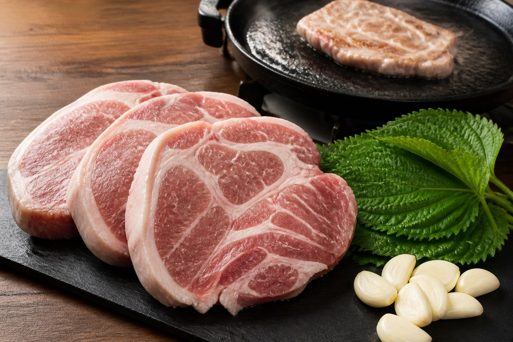

*▲ 돼지고기 목심 생것 100g은 227kcal, 단백질 17.21g, 지방 16.36g입니다. 같은 무게의 삼겹살(372kcal, 지방 33.31g)과 차이가 큽니다.*

한 줄 결론 <strong>돼지고기 목심 생것 100g은 227kcal, 단백질 17.21g, 지방 16.36g입니다(농촌진흥청 국가표준식품성분표).</strong> 같은 100g의 삼겹살은 <strong>372kcal, 지방 33.31g</strong>입니다. 팬에 구운 상태로 <strong>150g(성인 1인분 남짓)을 비교하면 삼겹살 726kcal·포화지방 22.5g, 목살 396kcal·포화지방 9.6g</strong>으로 <strong>열량 330kcal, 포화지방 13g</strong> 차이가 납니다. 단백질은 오히려 목살이 조금 더 많습니다. 고깃집에서 부위만 바꿔도 한 끼 지방의 절반이 사라진다는 뜻입니다.

돼지고기 하면 삼겹살이 먼저 떠오르지만, 집에서 자주 사 먹는 부위는 사실 목살입니다. 김치찌개, 제육볶음, 수육, 카레까지 목살이 들어가는 요리가 훨씬 많습니다. 그런데 정작 '목살이 얼마나 가벼운가'는 잘 모르고 씁니다.

저는 몇 해 전부터 삼겹살 한 줄 살 때 목살을 반씩 섞어 삽니다. 처음엔 값이 조금 싸서였는데, 막상 이렇게 해보니 <strong>같은 양을 먹고도 다음 날 아침 속이 훨씬 가벼운 쪽이 목살</strong>이었습니다. 그 차이가 기분 탓인지 숫자인지 확인해 보려고 성분표를 계산했습니다.

많이 검색되는 질문은 <strong>"목살 칼로리"</strong>, <strong>"목살이 삼겹살보다 좋은가"</strong>, <strong>"목살과 목심 차이"</strong>, <strong>"목살 굽는 법"</strong>입니다. 순서대로 다룹니다.

---

## 1. 목심 생것 100g 영양성분 (227kcal)

아래 표는 <strong>농촌진흥청 국가표준식품성분표(DB 10.4)의 '돼지고기, 목심, 생것' 가식부 100g</strong> 값입니다. 정육점에서 '목살'이라고 부르는 부위가 이 항목입니다(대분할 명칭 '목심', 소분할 명칭 '목심살').

| 영양 성분 (Nutrient) | 함량 (100g당) | 1일 기준치 비율 (2,000kcal 기준) |
| :--- | :--- | :--- |
| **열량 (Energy)** | 227 kcal | 11.4% |
| **수분 (Water)** | 62 g | 기준치 없음¹ |
| **단백질 (Protein)** | 17.21 g | 31% |
| **지방 (Total Fat)** | 16.36 g | 30% |
| - 포화지방산 (Saturated Fat) | 5.91 g | 39% |
| **탄수화물 (Carbohydrates)** | 0 g | 0% |
| - 식이섬유 (Dietary Fiber) | 0 g | 0% |
| **칼슘 (Calcium)** | 8 mg | 1.1% |
| **철분 (Iron)** | 0.73 mg | 6.1% |
| **칼륨 (Potassium)** | 301 mg | 8.6% |
| **나트륨 (Sodium)** | 51 mg | 2.6% |
| **비타민A (Vitamin A)** | 16 µg RAE | 2.3% |
| **비타민D (Vitamin D)** | 0.61 µg | 6.1% |
| **총 아미노산** | 15,263 mg | 기준치 없음¹ |

¹ 수분과 총 아미노산은 1일 기준치가 설정되지 않은 항목입니다. 비율은 식품의약품안전처 1일 영양성분 기준치(2,000kcal)로 계산했습니다.

*※ 데이터 기준: 농촌진흥청 국가표준식품성분표 '돼지고기, 목심, 생것' 2014년 분석값입니다. [USDA FoodData Central FDC 167843](https://fdc.nal.usda.gov/food-details/167843/nutrients) — Pork, fresh, shoulder, whole, separable lean and fat, raw는 100g당 236 kcal·단백질 17.18 g·지방 17.99 g·포화지방 6.24 g으로 국내 표와 10kcal 안쪽 차이입니다.*

### 표 읽는 법: 100g은 두툼한 한 장

- <strong>목살 100g은 두께 1.5cm로 썬 큰 한 장</strong>입니다. 고깃집 1인분(150~200g)을 먹으면 이 표의 1.5~2배를 먹는 셈입니다.
- <strong>단백질 17.21g은 같은 무게 삼겹살(13.9g)보다 많습니다.</strong> 지방이 적은 자리에 단백질이 그만큼 들어 있습니다.
- <strong>나트륨 51mg</strong>은 생고기 값입니다. 양념(간장·소금·된장)을 하면 이야기가 완전히 달라집니다.
- <strong>철분 0.73mg·칼륨 301mg</strong>은 돼지고기 살코기의 전형적인 값입니다. 붉은 살코기가 많은 목살이 삼겹살보다 이쪽은 유리합니다.

---

## 2. 같은 150g을 구우면 얼마나 차이 날까

성분표를 부위끼리 맞대어 놓으면 숫자가 크게 느껴지지 않습니다. 실제 식사 단위로 환산해 보겠습니다. 아래는 <strong>팬에 구운 상태 기준 100g 값</strong>과, 그것을 <strong>150g으로 늘린 계산값</strong>입니다.

| 돼지고기 (팬에 구운 것) | 열량 (100g) | 단백질 (100g) | 지방 (100g) | 포화지방 (100g) | 150g 먹을 때 열량 |
| :--- | :--- | :--- | :--- | :--- | :--- |
| **삼겹살** | 484 kcal | 22.78 g | 41.2 g | 15.0 g | **726 kcal** |
| **목심(목살)** | 264 kcal | 24.06 g | 17.23 g | 6.42 g | **396 kcal** |
| **안심** | 172 kcal | 30.23 g | 4.76 g | 1.74 g | **258 kcal** |

*※ 150g 열량은 100g 값을 1.5배 한 계산값입니다. 실제 조리 손실은 덩어리 크기와 불 세기에 따라 달라집니다.*

이 표에서 읽을 것은 세 가지입니다.

- <strong>열량 차이 330kcal.</strong> 밥 한 공기(약 300kcal)보다 큰 차이입니다. 같은 양을 먹고도 한 끼가 통째로 달라집니다.
- <strong>단백질은 목살이 더 많습니다.</strong> 24.06g 대 22.78g. 지방을 줄이면서 단백질은 오히려 챙기는 조합입니다.
- <strong>안심까지 가면 차이가 더 큽니다.</strong> 삼겹살 150g을 안심으로 바꾸면 468kcal가 줄지만, 안심은 씹는 맛이 담백해 기름진 맛을 기대하면 실망할 수 있습니다. <strong>개인적으로는 목살이 '맛과 지방의 균형'에서 가장 만족스러운 지점</strong>이었습니다.

---

## 3. 조리하면 100g 열량이 올라가는 이유

성분표를 보다 보면 이상한 점이 하나 있습니다. <strong>생것 227kcal인 목살이 구우면 264kcal, 삶으면 282kcal</strong>로 오릅니다. 고기를 익혔는데 열량이 늘어나는 걸까요.

아닙니다. <strong>수분이 빠져서 같은 100g에 고기가 더 많이 들어간 것</strong>입니다.

| 목심 (100g) | 열량 | 단백질 | 지방 |
| :--- | :--- | :--- | :--- |
| 생것 | 227 kcal | 17.21 g | 16.36 g |
| 팬에 구운 것 | 264 kcal | 24.06 g | 17.23 g |
| 삶은 것 | 282 kcal | 25.43 g | 18.56 g |

*※ 같은 농촌진흥청 성분표 계열의 목심 조리 상태별 값입니다.*

그래서 <strong>다이어트 계산을 할 때 기준을 하나로 고정해야</strong> 합니다. 마트에서 살 때 잰 무게는 '생것' 값으로, 식탁에 올라온 고기 무게는 '구운 것' 값으로 계산해야 맞습니다. 생것 200g을 사서 구우면 무게는 150g 남짓으로 줄지만, 그 150g이 실은 생것 200g이었던 셈입니다.

삶는 쪽이 열량이 더 높아 보이는 것도 같은 원리입니다. 수육은 기름이 국물로 빠져나가지만 <strong>동시에 수분도 빠지고, 고기 자체는 수축</strong>합니다. 기름을 걷어 낸다면 실제 섭취 열량은 구이보다 낮아질 수 있습니다. 국립축산과학원이 같은 부위의 경도를 비교한 결과에서도 <strong>삶은 삼겹살은 구운 것보다 71.5%, 삶은 목심은 63.3% 무르게</strong> 나왔습니다. 씹는 부담을 줄이려면 수육이 낫습니다.

---

## 4. 포화지방 7% 기준으로 보면 더 분명해진다

2025 한국인 영양소 섭취기준은 성인의 <strong>포화지방산을 총 에너지의 7% 미만</strong>으로 권고합니다. 하루 1,800kcal를 먹는 사람이면 <strong>14g</strong>이 상한입니다.

- <strong>구운 삼겹살 150g의 포화지방은 22.5g</strong>으로 상한의 <strong>161%</strong>입니다. 한 끼로 하루 상한을 넘깁니다.
- <strong>구운 목살 150g은 9.6g</strong>으로 상한의 <strong>69%</strong>입니다. 하루 안에 다른 식사까지 고려할 여지가 남습니다.
- <strong>구운 안심 150g은 2.6g</strong>으로 19%입니다.

콜레스테롤은 부위를 바꿔도 잘 줄지 않습니다. 같은 성분표에서 구운 것 100g의 콜레스테롤은 삼겹살 98.87mg, 목심 91.29mg, 안심 94.52mg으로 비슷합니다. <strong>부위를 바꿔서 줄일 수 있는 것은 열량과 포화지방</strong>이고, 콜레스테롤은 총 섭취량과 다른 식습관의 몫입니다.

---

## 5. 정육점에서 목살 고르기·굽기·보관

### 고르기: 라벨과 단면을 같이 본다

- <strong>라벨의 이름은 '목심'</strong>입니다. '목살'은 통용 명칭이고, 소분할 표시는 '목심살'입니다. '오겹살'은 부위 구분 기준에 없는 말이라 매장마다 뜻이 다릅니다. 껍질이 붙었는지 물어보고 사는 게 정확합니다.
- <strong>단면의 비계를 보세요.</strong> 목살은 근육 사이에 지방이 거미줄처럼 들어간 부위입니다. 흰 비계가 가장자리에 두껍게 붙은 덩어리는 지방이 훨씬 많습니다. 같은 목살이라도 <strong>가장자리 비계를 다듬은 제품은 열량이 100g당 20~30kcal 낮아질 수</strong> 있습니다.
- <strong>색은 선홍색, 표면은 촉촉하게.</strong> 갈색으로 변했거나 물이 고여 있으면 피를 뺀 지 오래된 것입니다.
- <strong>두께는 1.2~1.5cm.</strong> 너무 얇으면 금방 마르고, 두꺼우면 겉만 타기 쉽습니다.

### 굽기: 뒤집는 횟수를 줄인다

저는 목살을 구울 때 <strong>센 불에 앞뒤로 한 번씩만</strong> 뒤집습니다. 자주 뒤집으면 표면 온도가 계속 떨어져 육즙이 빠지고, 겉이 마르면서 속이 덜 익습니다. 두께 1.5cm 기준으로 한 면 <strong>3~4분</strong>, 가장자리 비계 쪽을 세워 <strong>30초</strong> 더 굽습니다.

중심 온도는 <strong>63℃(145℉)에서 3분 휴지</strong>가 기준입니다(미국 USDA 돼지고기 조리 기준). 고기 온도계가 없으면 <strong>가장 두꺼운 부분을 갈라 속이 분홍빛이 도는 우윳빛</strong>인지 보면 됩니다. 완전히 하얗게 익힐 필요는 없습니다.

에어프라이어는 <strong>200℃에서 12~14분</strong>, 중간에 한 번 뒤집으면 비슷한 결과가 나옵니다. 막상 이렇게 해보니 프라이팬보다 기름이 훨씬 적게 튀고, 설거지가 편한 쪽이 에어프라이어였습니다.

### 보관: 냉장 2~3일, 소분 냉동

- <strong>냉장은 2~3일</strong>이 기준입니다. 진공 포장이라면 표시 기한을 따르되, 개봉 후에는 3일 안에 드세요.
- <strong>냉동은 소분해서.</strong> 한 번 얼린 고기를 해동해 다시 얼리면 세포가 부서져 육즙이 빠지고 잡내가 늘어납니다. <strong>재냉동은 하지 마세요.</strong>
- <strong>해동은 냉장고에서 하루.</strong> 상온 해동은 표면만 따뜻해져 세균이 번식하기 쉽습니다. 급하면 비닐에 넣어 찬물에 담그는 정도가 안전합니다.

---

## 6. 섭취 시 주의사항

- <strong>지방이 적다고 해서 양을 늘리면 의미가 없습니다.</strong> 목살도 100g에 지방 16.36g입니다. 한 끼 100~150g이 현실적인 양입니다.
- <strong>가공육과 혼동하지 마세요.</strong> 목살로 만든 베이컨·소시지·훈제육은 나트륨과 지방이 훨씬 높습니다. 성분표의 생고기 값과 같지 않습니다.
- <strong>덜 익은 돼지고기는 위험합니다.</strong> 돼지고기에는 인수공통 기생충·세균 위험이 있어 <strong>중심까지 충분히 익혀야</strong> 합니다. 두꺼운 덩어리는 겉만 익히지 말고 온도계로 확인하세요.
- <strong>간을 세게 하면 무효입니다.</strong> 쌈장·소금·양념장으로 짜게 먹으면 나트륨이 하루 기준을 넘습니다. 마늘·후추·허브로 향을 올리는 편이 낫습니다.
- <strong>통풍·신장질환자는 양을 상의하세요.</strong> 단백질 17~24g/100g은 적지 않은 양입니다. 질환이 있으면 섭취량을 의료진과 정하는 게 안전합니다.

---

## 7. 자주 묻는 질문 (FAQ)

**Q1. 목살과 목심은 다른 부위인가요?**  
같은 부위입니다. '목심'이 식육 부위 구분 기준의 정식 명칭이고, '목살'은 정육점과 소비자 사이에서 통용되는 이름입니다. 소분할 표시는 '목심살'로 적힙니다. 라벨에서 목살을 못 찾으면 목심을 보면 됩니다.

**Q2. 목살이 삼겹살보다 단백질이 많나요?**  
네. 팬에 구운 것 100g 기준으로 목살 24.06g, 삼겹살 22.78g입니다. 생것으로 비교해도 목심 17.21g, 삼겹살 13.9g으로 차이가 더 큽니다. 다만 단백질만 보고 양을 늘리면 지방도 함께 늘어납니다.

**Q3. 수육으로 먹으면 칼로리가 낮아지나요?**  
조리 후 무게 기준으로는 삶은 목심이 282kcal로 구운 것(264kcal)보다 높게 나옵니다. 수분이 더 빠져 같은 100g에 고기가 더 많이 들어가기 때문입니다. 다만 삶으면 기름 일부가 국물로 빠지므로, <strong>기름을 걷어 내고 먹으면</strong> 실제 섭취 열량은 구이보다 낮아질 수 있습니다.

---

## 8. 목살과 함께 먹으면 좋은 조합

- <strong>[삼겹살 (Pork Belly)](/posts/pork-belly-nutrition-benefits/):</strong> 같은 돼지고기지만 지방 구성이 다릅니다. 두 부위를 반씩 섞어 사면 맛과 열량의 균형을 맞추기 쉽습니다.
- <strong>[돼지고기 안심 (Pork Tenderloin)](/posts/pork-tenderloin-nutrition-benefits/):</strong> 더 담백한 쪽을 원할 때의 선택지입니다. 구운 안심은 172kcal로 목살의 3분의 2 수준입니다.
- <strong>[양배추 (Cabbage)](/posts/cabbage-nutrition-benefits/):</strong> 목살구이에 곁들이면 식이섬유와 포만감을 함께 채울 수 있습니다. 쌈으로 먹을 때 소금·쌈장 양이 줄어듭니다.
- <strong>[마늘 (Garlic)](/posts/garlic-nutrition-benefits/):</strong> 목살의 잡내를 잡고 향을 올려 줍니다. 고기 양을 줄이고 마늘을 늘리는 방식이 나트륨 관리에 유리합니다.

  
📌 관련 순위 가이드

  <ul>
    <li><a href="/posts/high-protein-foods-ranking/">단백질 많은 음식 순위</a></li>
    <li><a href="/posts/low-calorie-high-satiety-foods/">칼로리 낮고 포만감 높은 음식</a></li>
  </ul>

---

## 9. 한 줄 정리

- 목심(목살) 생것 100g은 <strong>227kcal, 단백질 17.21g, 지방 16.36g, 포화지방 5.91g</strong>입니다.
- 같은 100g의 삼겹살은 <strong>372kcal, 지방 33.31g</strong>입니다. 생것만 봐도 열량이 1.6배입니다.
- 팬에 구운 <strong>150g 기준으로 삼겹살 726kcal·포화지방 22.5g, 목살 396kcal·9.6g</strong>입니다. <strong>열량 330kcal 차이</strong>입니다.
- 단백질은 <strong>목살 24.06g, 삼겹살 22.78g</strong>으로 목살이 더 많습니다.
- 조리 후 100g 열량이 올라 보이는 건 <strong>수분 손실</strong> 때문입니다. 생것 무게와 조리 후 무게를 섞어 계산하지 마세요.
- <strong>중심 63℃에서 3분 휴지</strong>, 냉장 2~3일·소분 냉동·재냉동 금지가 기본입니다.

**추가 근거:** 영양 수치는 농촌진흥청 국가표준식품성분표(DB 10.4)의 '돼지고기, 목심·삼겹살·안심' 생것·삶은 것·팬에 구운 것 항목이고, 비교는 USDA FDC 167843(Pork, fresh, shoulder, whole, raw)과 대조했습니다. 포화지방 상한은 2025 한국인 영양소 섭취기준(총에너지 7% 미만)을 따랐고, 조리 후 경도 비교는 국립축산과학원 자료, 부위 명칭은 식품의약품안전처 고시 「소·돼지 식육의 표시방법 및 부위 구분기준」을 참고했습니다.
